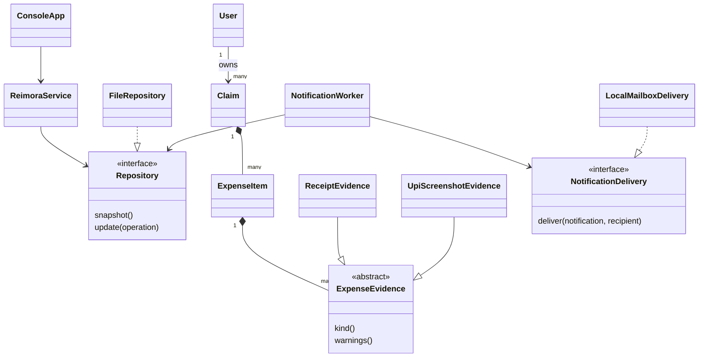

# OOP concepts demonstrated in Reimora

The terminal interface is separate from the business rules. Domain services depend on storage and delivery interfaces. The project uses only Java's standard library and targets Java 17 bytecode.

| Syllabus concept | Actual implementation | Demonstration |
|---|---|---|
| Classes and objects | `Models.User`, `Models.Claim`, `Models.ExpenseItem`, `Models.Advance` | Create users, claims, expenses and advances from menus. |
| Constructors | Constructors in domain models, `ReimoraService`, `Reports`, and evidence subclasses | A new claim requires identity, purpose and creation time. |
| Encapsulation | Private fields; getters return copied lists; domain mutations occur through service transactions | A caller cannot alter a claim's status by modifying a list returned by a getter. |
| Inheritance | `ReceiptEvidence` and `UpiScreenshotEvidence` extend `ExpenseEvidence` | A receipt and a screenshot share file metadata but have different evidence rules. |
| Abstract class | `ExpenseEvidence` declares abstract `kind()` and `warnings()` | An abstract evidence object cannot be constructed directly. |
| Method overriding | Both evidence subclasses override `kind()` and `warnings()` | A pending UPI payment produces a warning; a receipt checks its invoice reference. |
| Runtime polymorphism | `ExpenseItem` stores a `List<ExpenseEvidence>`; service calls `e.warnings()` | The same loop invokes different subclass behaviour. |
| Method overloading | `createClaim(actor, title, purpose)` and `createClaim(actor, student, title, purpose)`; two `claims(...)` methods | Students create their own claims; administrators can create a claim for a selected student. |
| Interfaces / abstraction | `Repository`, `ReceiptParser`, `NotificationDelivery`, `ReportExporter` | File persistence, text extraction and mailbox delivery have replaceable implementations. |
| Composition | A claim owns expense items, payment records, history and submission revisions | Removing an item from the current revision does not remove an archived submission snapshot. |
| Access modifiers and packages | `reimora` package, private domain fields, package-private mutation helpers | Public service operations enforce role and state checks. |
| Collections | `LinkedHashMap`, `List`, `EnumMap`, `Set` | Store records by ID, retain display order, aggregate category totals and deduplicate warnings. |
| Exception handling | Custom `DomainException`; checked file errors converted to understandable messages | Try an invalid approval, oversized payment or unsupported file. |
| File handling and streams | `FileRepository`, `DocumentStorage`, `TextReceiptParser`, `Reports` | Restart the application, import a receipt, and export a CSV/text report. |
| Multithreading | `NotificationWorker implements Runnable`; single-thread scheduled executor | Inbox events are written to local message files while the menu continues accepting input. |
| Synchronization | Synchronized repository snapshots/transactions and notification worker | Concurrent settlement attempts cannot both spend the same remaining balance. |
| Resource management | `AutoCloseable` and try-with-resources | File handles, application lock and background worker close on normal exit. |

## Main class relationships

`User`, `Claim`, `ExpenseItem`, and other closely related model types are nested classes/records in `Models.java`. This groups the small model definitions without merging them into the terminal UI.

## Entry points worth reading first

1. `Main.java`: constructs the repository, service, storage, report writer and worker.
2. `ConsoleApp.java`: terminal menus and prompts.
3. `ReimoraService.java`: permissions, workflow, approval and settlement rules.
4. `Models.java`: domain data and object behaviour.
5. `ExpenseEvidence.java`, `ReceiptEvidence.java`, `UpiScreenshotEvidence.java`: inheritance and polymorphism.
6. `FileRepository.java` and `NotificationWorker.java`: persistence and multithreading.

No claim is made that every language feature in the syllabus is necessary to this application. The mapping describes code that actually runs.
