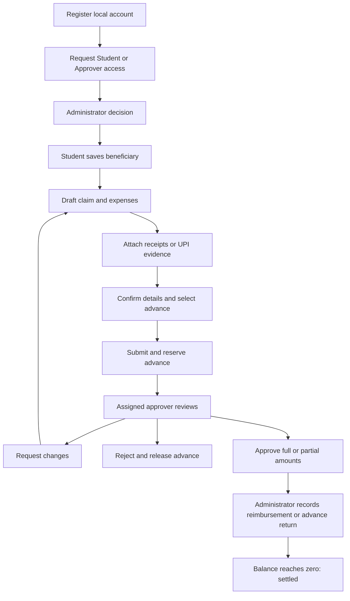

# Reimora — terminal mini-project report

**Student:** Pratik Deepak Phapale  
**PRN:** 125B1F210  
**Institution:** Pimpri Chinchwad College of Engineering, Pune  
**Department / class:** Information Technology, Second Year, Semester III, Division B  
**Course:** Object-Oriented Programming Laboratory  
**Faculty:** Tanuja Patankar

## Problem statement

Students buy materials for academic activities and submit expenses for reimbursement. A reviewer needs to inspect evidence and accept eligible amounts. Finance must deduct advances correctly, record payments, and prevent repeated settlements. Reimora models this workflow in a Java terminal application with local files.

## Objectives

- Model people, claims, expenses, evidence, advances and payments as objects.
- Distinguish account access from claim approval and financial settlement.
- Preserve records between runs and keep an audit history.
- Demonstrate inheritance, interfaces, polymorphism, exceptions, file handling and background work.
- Provide a complete offline demonstration without paid services or external dependencies.

## Roles

| Role | Permissions |
|---|---|
| Pending applicant | Sign in, view/request/withdraw access, and read own local notifications. |
| Student | Manage own beneficiary and drafts, attach evidence, submit/withdraw claims, view own advances, notifications and reports. |
| Approver | Read assigned claims in the allowed branch scope and approve, request corrections, or reject. |
| Administrator | Approve role requests, suspend accounts, create claims on behalf of students, assign reviewers, record advances/payments/returns, export reports and inspect audit/delivery logs. |

There is one active primary role per account. The administrator can grant an approver either their own branch or all-branch scope. Club-specific assignment and multiple simultaneous roles are outside this terminal edition. The administrator cannot approve their own reimbursement.

## Modules

1. **Account and access:** local password login and admin-reviewed access requests.
2. **Beneficiary:** versioned holder/bank/IFSC details with an encrypted account identifier and masked display. The terminal does not reveal the full saved identifier.
3. **Claims:** draft creation, expense items, evidence attachments, submission revisions and review.
4. **Evidence:** copied TXT/PDF/PNG/JPG/WebP attachments, hashes, references and warnings.
5. **Text import:** structured `key: value` receipt parsing with user-reviewed keyword category suggestions.
6. **Finance:** advances, allocation reservations, exact-decimal calculations and partial settlements.
7. **Notifications:** persistent inbox plus local mailbox files generated by a background worker.
8. **Reports:** scope-limited dashboard, CSV export, printable claim summary and history.

## Workflow



## Settlement rules

All money is stored as `BigDecimal` with two decimal places. Inputs with sub-paise fractions are rejected rather than silently rounded.

`net settlement = total approved expenses - advance applied`

- Positive result: the college owes the student money.
- Negative result: the student must return unused advance money.
- Zero result: no further payment is required.

An advance selection in a draft does not reserve money. Submission reserves it. A changes-requested claim keeps the reservation. Rejection or withdrawal releases it. Approved allocations remain accounted for even after settlement, preventing reuse of already consumed advance funds.

Unallocated advance returns are recorded separately. Returns associated with an approved claim use that claim's settlement operation.

Example A: INR 2,650 approved minus INR 2,000 advance leaves INR 650 payable. Recording INR 300 and then INR 350 settles the claim.

Example B: INR 1,700 approved minus INR 2,000 advance leaves INR 300 returnable. Recording two returns of INR 100 and INR 200 settles the claim.

## Evidence rules

One expense can have both a receipt and a payment screenshot. Adding evidence never changes the expense amount. Files are copied into the application's evidence directory; original files are preserved.

The program warns about repeated file hashes, repeated same-type references and matching vendor/date/amount combinations. Missing invoice references and pending/failed/unknown UPI statuses produce warnings. Reviewers must document how warnings were resolved before approving. These are review aids, not fraud detection or bank verification.

TXT receipts can contain these fields:

```text
Vendor: Demo Campus Stationery
Amount: 2650.00
Date: 2026-10-14
Reference: DEMO-BILL-001
Items: Notebooks and pens
Purpose: College project materials
```

The parser extracts these labelled fields. Category suggestions use words in the items/purpose. A vendor name alone does not establish purchase purpose. Image and PDF contents are not scanned.

## Persistence and concurrency

`FileRepository` stores a serialized local state using a restricted deserialization filter. Every mutation operates on a detached copy, saves it, and replaces the live state only after persistence succeeds. Invalid business operations therefore do not partially change live data.

Writes use a temporary file followed by replacement. The previous saved state is retained as a backup. A lock prevents two application instances from writing the same workspace. Repository operations are synchronized so terminal actions and the notification worker cannot overwrite each other's changes.

Local notifications are queued inside the same state update as the business event. The worker then writes deterministic message filenames. Repeated processing does not create multiple files for one message. Failed writes remain visible and may be retried. No SMTP connection or external email is involved.

## Academic demonstration

1. Run `run.bat`. Choose the administrator password and sign in.
2. Register a new student, then approve their request from the administrator account.
3. Alternatively, use the administrator's demo-data option and choose a demo password.
4. Sign in to the demo student account. Its fictional beneficiary and INR 2,000 advance already exist.
5. Create a claim and import `samples/stationery-receipt.txt`. Confirm/edit fields and attach the file.
6. Select the advance and submit.
7. Sign in to the demo approver. Read the claim and approve INR 2,650.
8. Sign in to the administrator and record INR 650 using a unique fictional reference.
9. Export the claim summary and CSV. Read the student's notifications and inspect local mailbox delivery.
10. Exit and restart to demonstrate persistence.

Record IDs are generated by the application. Use the IDs displayed in your own session rather than assuming fixed IDs.

## Limitations and future work

- This is a local, terminal-only academic application; operating-system users who can access its data directory can access those files.
- Google login, AI/OCR, real email delivery, bank APIs and actual money transfers are not implemented.
- Claims cannot be reopened after approval, rejection or withdrawal. A new claim can be created where needed.
- The encryption key is stored locally. Back up the complete data directory and protect it using operating-system access permissions.
- File-header validation is basic and is not malware scanning. Image/PDF evidence is retained for manual inspection outside the application.
- Possible future extensions: database persistence, email provider adapter, visual OCR with human confirmation, multiple roles, club scopes and a graphical interface.

## Viva questions

1. **Why use OOP here?** Users, claims, evidence and payments have state and behaviour that can be grouped into domain objects.
2. **Where is encapsulation?** Models keep fields private, expose read methods and use controlled mutation methods invoked by the service.
3. **Where is inheritance?** `ReceiptEvidence` and `UpiScreenshotEvidence` inherit shared metadata from `ExpenseEvidence`.
4. **How is polymorphism demonstrated?** A loop over `ExpenseEvidence` invokes each subtype's overridden warning method.
5. **Why use interfaces?** They isolate contracts such as storage and notification delivery from the implementation used today.
6. **Where is overloading?** `createClaim` has an own-claim overload and an administrator-on-behalf overload; claim search also has overloads.
7. **Why `BigDecimal`?** Binary floating-point can represent decimal currency imprecisely; exact decimals support reliable totals and comparisons.
8. **Where is multithreading?** A scheduled `Runnable` processes local notifications while the main thread handles terminal input.
9. **How do you avoid double payment?** The service verifies status, remaining balance and unique references inside a synchronized repository transaction.
10. **What happens after a failure?** Invalid operations leave saved business state unchanged. Notification failures are separately recorded; corrupt saved state causes a clear startup error instead of a silent reset.
